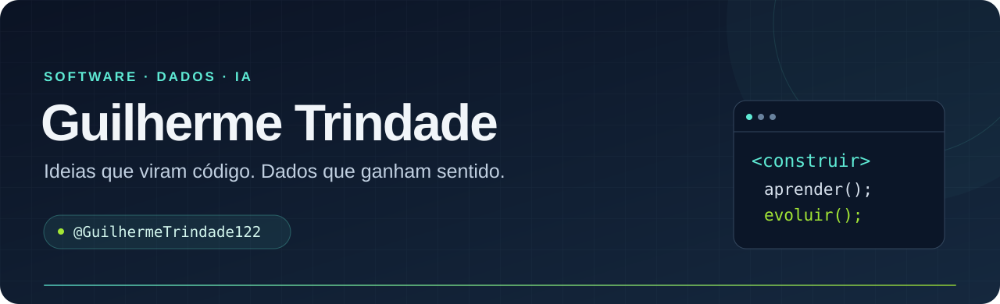

  

<h2 align="center">Olá, eu sou o Guilherme 👋</h2>

  Transformo problemas em projetos: de uma API com regras de negócio a uma análise que ajuda a entender os dados.

- 🔭 Foco em **backend**, **aplicações web** e **dados & IA**
- 🌱 Trabalhando com **Java/Spring Boot**, **Python/FastAPI** e **React**
- 🤖 Explorando **agentes de IA** com LangChain e Gemini (veja o [Assessor.AI](https://github.com/GuilhermeTrindade122/my-acessor))
- 📊 Estudando **ciência de dados**: EDA, clustering, classificação e Power BI
- 🏗️ Documento decisões de arquitetura (ADR) e escrevo testes nos projetos
- 💬 Pergunte-me sobre: Java, Python, SQL, Redis, Docker e GitHub Actions

<h2 align="center">Tecnologias 🧑‍💻</h2>

<b>Backend & Web</b>

  

<b>Bancos de dados & Cache</b>

  

<b>Dados & IA</b>

   
  SQL · scikit-learn · LangChain · Jupyter

<b>DevOps & Ferramentas</b>

  

<h2 align="center">Projetos em destaque ⭐</h2>

Clique nos cards para explorar o código e a documentação.

  
  

  
  

  
  

<h3 align="center">Também vale explorar</h3>

- [**Consulta com cache**](https://github.com/GuilhermeTrindade122/consultation_system) — consultas de produtos com PostgreSQL e Redis.
- [**Prática DevOps**](https://github.com/GuilhermeTrindade122/pratica-devops) — aplicação Flask com Docker e pipeline no GitHub Actions.

<h2 align="center">Estatísticas 📈</h2>

  
  

<h2 align="center">Vamos conversar 🤝</h2>

  
  <!-- Adicione seu LinkedIn:
   -->

---

  <b>Código, dados e aprendizado na prática.</b> 
  <a href="https://github.com/GuilhermeTrindade122?tab=repositories">Explorar todos os repositórios →</a>

